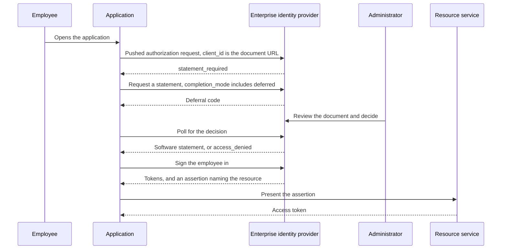

# Sketch: Tenant Admin Consent Without a Stored Grant

Tenant-wide admin consent is the most widely deployed enterprise authorization ceremony that no open standard describes. This sketch takes Microsoft Entra ID's version as the reference, because it is the one most people mean, and asks what each of its parts looks like built from specifications instead. It is non-normative and it is not a draft.

The short version: three of its four parts have generic forms already, though the generic request-and-decide loop standardizes only the client's side. The fourth, a consent covering a whole population, has no form anywhere. That property has real value, and this family leaves it to each server's policy rather than standardizing it.

## What the ceremony actually does

Four parts, worth separating because they are usually discussed as one act.

| Part | In Entra |
| --- | --- |
| The app becomes known to the tenant | A `servicePrincipal`, created when some user first consents, or created disabled when a reviewer blocks a request |
| Someone asks, an administrator decides | An `appConsentRequest` fanning out to `userConsentRequest` objects, reviewers notified by email, statuses running `Initializing`, `InProgress`, `Expired`, `Completed` |
| The decision is recorded | An `oauth2PermissionGrant` with `consentType` of `AllPrincipals` and a null `principalId` for delegated permissions, an `appRoleAssignment` for application permissions |
| It is withdrawn | The grant row is deleted |

Two properties of that shape matter more than any of the parts.

**The request workflow has no approval API.** Microsoft Graph exposes consent requests for listing and reading only, with no method to approve or deny one, so a pending request is resolved in the portal or through the consent URL it implies. That does not stop an enterprise automating consent itself: Graph can create a tenant-wide delegated permission grant, with `consentType` of `AllPrincipals`, or an application permission assignment directly, with no consent prompt. What lacks an automatable form is the link between a user's request and an administrator's decision. The `/adminconsent` endpoint returns no code and no token, only `admin_consent=True` with a `tenant` value the documentation warns must never be used to authenticate or authorize.

**The record is permanent and local.** A grant does not expire, nobody re-reviews it, and deleting it does not reach tokens already issued: existing access tokens remain valid for their lifetime, and only new ones are refused. Revocation is also not sticky, since users can re-consent afterwards. The grant is verifiable only inside the directory that holds it.

## Population, persistence, and review cadence

Tenant-wide admin consent bundles three properties that are worth judging separately:

* **Population.** One decision covers every user in the tenant. This is what enterprises adopt it for: users are not prompted about software the organization has already decided on, and someone accountable makes the decision once.
* **Persistence.** The decision is a stored grant with no expiry.
* **Review cadence.** Nothing prompts anyone to revisit it.

The first is legitimate, and this family leaves it alone: whether a server prompts users, and for which scopes, stays its own policy. The second and third are what the family changes, for the decision to let the software in at all. That decision becomes a statement that expires unless renewed, names exactly which document was approved, and can be withdrawn through a published status that every server trusting the reviewer can check.

## Mapping the parts

| Part | Generic form | Status |
| --- | --- | --- |
| App known to the tenant | A Client ID Metadata Document URL that resolves. No provisioning step exists to precede the request | Available |
| Ask and decide | The issuance flow: an authorization request with `completion_mode` including `deferred`, a `software_statement_code`, redemption returning a deferral code, polling, then a statement or a terminal `access_denied` | Available for the client's side; how the approver decides stays local |
| Record the decision | A software statement: an issuer, an expiry, a digest binding it to the exact document reviewed, and a status reference for withdrawal | Available |
| Consent for all users | Nothing, anywhere; consent placement stays server policy | Deployment policy |
| Withdraw | Set the statement's status, and stop renewing | Available |

### Provisioning

In the portal, an administrator usually grants consent to an app already present in the tenant, often because a user consented to it or requested it first. That is one path, not a requirement: Microsoft documents a tenant-wide admin consent URL that an administrator can build from the app's client ID alone, so no user has to go first.

A client identified by a Client ID Metadata Document needs no provisioning step at all. Its identifier is a URL that resolves to its metadata, so it can ask for admission before anyone has consented to anything, and the authorization server holds nothing for it until a decision exists.

### The client's side of the ceremony is specified

The request-and-approve loop maps onto the issuance draft in shape: the client asks, the decision is pending, and the client learns the outcome. What the issuance draft standardizes is the client's side: an interoperable request, a deferral, polling, and a result that is either a statement or a defined denial, terminal for the request without precluding a later one. How the administrator decides, and how an approval system plugs into the authorization server, it leaves out of scope, as Entra leaves its own approval to the portal. The gain is interoperable delivery of the result, not an automated approver.

### The decision becomes an artifact worth auditing

An `oauth2PermissionGrant` is a row. It says a grant exists; who made it lives in the directory's audit log, and nothing records which version of the software was approved or when the approval lapses. A statement carries the issuer, an expiry the reviewer chose, and a digest naming the exact bytes of the document that was approved, so a later reader can tell whether the software still matches what was reviewed. Withdrawal is a published status any relying party can resolve rather than a deletion visible only to the directory that performed it.

For an enterprise with more than one vendor, that last property is the point. The same decision is checkable at every provider that trusts the reviewer, which is the case [the deployment model](deployment-model.md#the-situation-being-addressed) opens on. Where the decision is the tenant's own, the statement names the provider's tenant in `aud_tenant`, and the provider can require that reviewer's statement for the software there.

## The part with no generic form

Nothing in any open specification expresses a consent that binds a population rather than a principal. `consentType: AllPrincipals` has no analog in OAuth 2.0, OpenID Connect, Rich Authorization Requests, CIBA, OpenID Federation, or the OpenID Foundation's Grant Management for OAuth 2.0, which is client-initiated and scoped to a resource owner.

The two nearest efforts both miss it, in ways worth knowing:

* **`draft-dellaert-oauth-approval-based-dcr`**, an individual draft at revision `-00` with no working group adoption, applies the device-flow shape to registration. It approves a *client registration* rather than a *consent*, and leaves the approver's identity and trust model to server policy. There is no notion of approving on behalf of a population.
* **The AuthZEN Access Request and Approval Profile**, an adopted OpenID AuthZEN working group draft, models request then approve for an *access* decision: a denial carries an access request, the enforcement point submits one, polls a status, and re-evaluates on approval. It puts workflow engines, approval policy languages, and approver-facing inbox APIs out of scope, and it leaves who may approve for whom to the access request service.

So that profile and this family are complementary rather than competing. One is "a user needs access and an approver decides." The other is "software needs admission and a reviewer decides." Neither expresses a decision covering everybody.

## What this family replaces, and what it leaves alone

The family does not standardize a consent covering a population, and it does not argue that one is wrong. Placing consent for a population stays the authorization server's policy, where it is today. What the family replaces is the persistence and review cadence of the decision to admit the software: that decision becomes an expiring, digest-bound statement rather than a row that lasts until someone deletes it. Where the enterprise identity provider mediates each grant, its willingness to issue an assertion carries the tenant's permission at every grant. Ceasing to issue stops new assertions at once, though an assertion already issued can still open a grant until it expires, a grant it opened continues under the provider's refresh policy if a refresh token was issued, and access tokens run out on their own clock either way.

The scope question needs no artifact either. The reviewed document's `scope` is already a ceiling, since a request outside it fails with `invalid_scope`. Where a server places consent inside that ceiling, and whether it prompts a user at all, is its own policy and is the right thing to leave alone.

## The flow

The first exchange is shown as a pushed authorization request because that is where the client would later present a statement. The refusal itself also reaches a plain authorization request, returned through the redirection after the server validates the redirect URI against the resolved document.

## What this does not replace

* **Placing consent so users are not prompted.** That is what admin consent is usually bought for, and it stays local policy at the authorization server. Nothing here tells a server when to skip a consent screen.
* **Assigning users and groups to an application.** Entra treats that as a separate control from consent, and it stays separate here, on the identity provider's side.
* **Application permissions with no user.** An `appRoleAssignment` to a service principal is an app-only grant. The family admits the software and says nothing about what it may do without a user, which [the deployment model](deployment-model.md#variants) already names as the case it serves least well.
* **Anything retroactive.** Like Entra, withdrawal does not invalidate tokens already issued. A provider refuses new admission and refresh once it learns of a withdrawal, at its next status resolution. At the statement's expiry new admission stops, and refresh stops only where the provider requires a current statement. Access tokens already issued run until they expire.

## Open questions

* **Where does per-user assignment belong** when the identity provider is also the reviewer? Today the assertion carries it implicitly, and nothing makes the two decisions distinguishable in an audit.
* **Should a denial be durable?** Entra's Block creates a disabled service principal and prevents future requests, while a plain Deny lets the requester ask again. The issuance draft's terminal denial binds one request only, which is deliberate, but an administrator who has said no may expect that to stick.
