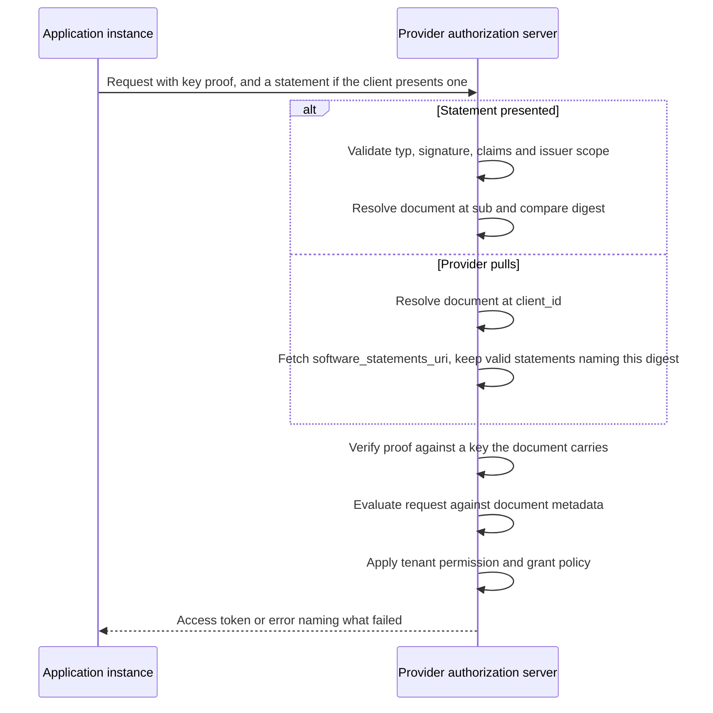

# Deployment Model: Portable Review Across Many Authorization Servers

This is a non-normative companion to the five drafts in this repository. It sketches one end-to-end deployment, names the actors, and shows which part of each draft carries which decision. Nothing here is normative; where this document and a draft disagree, the draft wins.

* [CIMD Software Statement](../draft-mcguinness-oauth-cimd-sw-stmt.md), the statement draft: the artifact, its validation, issuer trust, and admitting a client at request time on a statement it presents or the provider pulls.
* [CIMD Software Statement Registration](../draft-mcguinness-oauth-cimd-sw-stmt-registration.md), the registration draft: consuming a statement in an RFC 7591 registration, which the statement bounds and a replacement renews.
* [CIMD Software Statement Issuance](../draft-mcguinness-oauth-cimd-sw-stmt-issuance.md), the issuance draft: how a client obtains one.
* [CIMD Software Statement Lifecycle](../draft-mcguinness-oauth-cimd-sw-stmt-lifecycle.md), the lifecycle draft: withdrawal and refusal records, supersession, requiring a current statement on refresh, and refresh replacement, with Token Status List as an optional withdrawal mechanism and an event telling a provider that a status changed, so it resolves sooner than its schedule would. The statement draft requires none of this; the attested-keys draft depends on it.
* [CIMD Software Statement Attested Keys](../draft-mcguinness-oauth-cimd-sw-stmt-attested.md), the attested draft: an extension in which an attester the provider trusts vouches for an installation's key, so a native application can be admitted with loopback redirects through PAR.

Claims here are of three kinds, and the text says which where it matters: **defined by the drafts** (a draft in this repository specifies it), **deployment policy** (a choice the drafts leave to an operator), or **proposed extension** (something no draft defines yet).

## The situation being addressed

An enterprise runs software from many vendors. Its people install software the enterprise did not procure. Vendor-hosted applications connect to other vendor-hosted applications on its behalf. Every one of those connections is an OAuth client at some authorization server, and there are many authorization servers.

Two review functions are at work, and they are routinely conflated:

* A provider's marketplace decides which software may exist as a client on its platform. It runs a listing process with security review, branding checks, and a contract.
* A customer decides which of that software may operate in its tenant. It runs procurement, security review, and a data-protection assessment.

Neither substitutes for the other. **These drafts carry the first.** The second is answered on the customer's own clock. Where the customer's identity provider mediates the grant it is already answered continuously, by whether that provider issues an assertion at all; where it does not, a customer can operate a reviewer of its own and carry its decision as a statement confined to its tenant ([step 4](#4-the-customer-decides-which-software-may-operate-in-its-tenant)). Trying to carry both decisions in one artifact was the design this family started from and abandoned; the reasons are in [Composition with ID-JAG](#composition-with-id-jag).

Whether an administrator accepting risk deserves a different claim from a marketplace attesting quality is an open question. These drafts answer no, and treat both as one reviewer role.

## What this profile supplies

None of the capabilities below is new on its own. RFC 7591 software statements carry signed metadata at registration, OpenID Federation bounds a registration's validity by its trust chain and resolves issuer trust, and a Client ID Metadata Document already lets a server admit a client without registering it. What this CIMD profile supplies is the three together, for a client whose metadata is a document it hosts:

* **Registrations whose metadata comes from a reviewed document.** A registration made with a statement under the registration draft takes its metadata from the reviewed document, not from the request. The redirect URIs, keys, and branding on the registration are the ones an issuer looked at.
* **Registrations that lapse with the decision behind them.** Validity is the governing statement's effective expiry, and renewal is a replacement statement. RFC 7591 defines neither.
* **Admission on a review without registration.** A statement the client presents, or one the provider pulls from where the client's document points, admits the client for the grant it opens and creates no registration, which suits client populations too numerous or too short-lived to register.

The customer-side story is worth stating plainly: a determined enterprise can already hold one approval record and drive each provider's administrative API from it, unilaterally, today. What that does not give it is a decision the provider verifies rather than trusts, or registration metadata bound to a review.

As deployment policy, a provider can adopt this in two rungs and needs no counterparty for the first. It issues statements from its own listing program that name `registration` in `statement_uses`, consumes them under the registration draft's validity model, and gets delistings that actually take effect. Then it admits clients at request time: on statements presented at the token endpoint by clients that need no redirect, or at the pushed authorization request endpoint by software distributed to end users, which cannot hold a key its document carries, and on statements it pulls from where a client's document points. Either rung asks listed publishers for little more than a hosted metadata document.

## Four layers

| Layer | Question | Decider | Artifact | Lifecycle |
| --- | --- | --- | --- | --- |
| Admission | Which software may exist as a client here? | A reviewer the provider trusts | Software statement | Review and renewal |
| Tenant permission | Which admitted software may operate in my tenant right now? | The customer | Whether its identity provider issues an assertion, or a statement from the customer's own reviewer naming its tenant | Per grant, or the statement's lifetime |
| Presenter proof | Which instance is making this request? | The reviewed document, through a key it carries or the redirect URIs it names | Client authentication, DPoP, or PKCE to a reviewed redirect URI | Per request |
| User grant | What may it access, for whom? | Resource owner and local policy | Access grant, or a cross-domain identity assertion | Grant and token lifetime |

The drafts define the admission layer. Presenter proof is ordinary client authentication or DPoP, or, for software distributed to end users, the reviewed redirect URIs and PKCE ([step 3](#3-the-application-registers-or-does-not)). Tenant permission belongs to the customer, usually through its identity provider, and the user grant to OAuth itself.

## Actors

| Actor | Holds | Issues or presents |
| --- | --- | --- |
| Software publisher | The software's identity, a Client ID Metadata Document URL | Publishes the document; obtains statements over it |
| Reviewer | A review process: a marketplace listing program, an ecosystem directory, or an enterprise's own | Statements naming the software, the reviewed digest, and where they may be used |
| Provider authorization server | Registrations, trust configuration | Validates statements, resolves documents, registers or admits clients |
| Enterprise customer | Its permission decision, and optionally a review process of its own | Assertions for permitted applications; statements where it wants a portable review record |
| Client instance | A key the reviewed document carries, or one of its own where the software is distributed to end users | Proves that key at request time |

## End to end

### 1. The publisher gives the software an identity

A Client ID Metadata Document at an HTTPS URL: domain-anchored, retrievable, and bindable to its exact bytes. Software that cannot host one is outside this family and registers as it does today.

### 2. A reviewer evaluates the document and issues a statement

The reviewer fetches the document, evaluates it, and signs a statement naming the software as `sub`, the digest of the exact bytes it reviewed as `cimd_digest`, the servers where the review should hold as `aud`, and an expiry reflecting how often it re-checks. If the review should also govern registrations, it names `registration` in `statement_uses`; without that, the statement is usable only at request time. The statement carries no metadata of its own: the document is the metadata, and the digest says which version of it was reviewed.

The publisher can hand the statement to its clients, or publish it at the `software_statements_uri` its document names so that providers fetch it themselves.

### 3. The application registers, or does not

Registering, with a statement that permits it, the application presents the statement in an ordinary RFC 7591 request. The provider resolves the document at `sub`, verifies its digest against the statement, and registers the client with **that document's** metadata, taking nothing from the request. Where the provider implements the registration-validity model, it records the statement's identity and an effective expiry, the earlier of the statement's own and the maximum lifetime the provider honors for that issuer, and the registration is valid until then. A registration created from a statement that is not confined to a tenant serves every tenant on the platform, so onboarding a customer requires no new registration. One created from a tenant-confined statement is restricted to that tenant.

Not registering, an application identified by its metadata URL presents the statement in a token request or a pushed authorization request, or the provider pulls it from the location the document names, and the application is admitted for the grant that opens, with no registration created. A confidential client proves a key the reviewed document carries. Software distributed to end users proves a key of its own instead, bound by the redirect URIs the reviewer looked at. Where any of those URIs could be claimed by another application on the device, a loopback redirect for instance, the statement is review-only: the provider can record the review but admits nothing on it.

### 4. The customer decides which software may operate in its tenant

A different decision, on a different clock. Where the customer's identity provider mediates the grant it is already answered: the provider issues an assertion for applications the customer permits and none for the rest, so enforcement happens at every grant. Withdrawing stops new assertions at once, though an assertion already issued can still open a grant until it expires ([step 8](#8-offboarding)). The drafts add nothing there.

A customer that wants its decision to travel as an artifact, because it needs an auditable record or because the provider is reached without its identity provider in the path, operates a reviewer of its own. Its statements name the provider's tenant in `aud_tenant`, so they apply in that tenant and nowhere else. The provider configures the customer's reviewer for that tenant and records the identifier namespaces for which the customer's decision is required there, so only the customer's current statement admits that software in that tenant, whatever the marketplace listing says. A request still carries one statement: the customer's in that tenant, the listing elsewhere. When the customer stops renewing or withdraws, the software lapses in that tenant and nowhere else, and withholding the customer's statement does not fall back to the listing. The rules are defined by the drafts; requiring the customer's reviewer is deployment policy.

### 5. The provider configures the reviewers it trusts

Once per reviewer: the issuer identifier, its statement key set, from its authorization server metadata or at a URL recorded in the trust configuration, which holds no key the reviewer signs anything else with, the signing algorithms accepted from it, the client identifier namespaces it may speak for, the audiences it may name, a maximum statement lifetime, and a policy on multiple registrations from one statement. For a customer's own reviewer it also records the tenant and the namespaces for which that reviewer's decision is required. That is the entire per-reviewer cost, and it does not recur per application.

### 6. A request arrives

When the client presents a statement, everything that needs no network happens before the document is fetched, which keeps an unauthenticated request from spending retrieval on a statement that was never going to validate. When the provider pulls, the document comes first, since it names where the statements are published, and the checks-before-retrieval ordering applies from the first statement the provider verifies.

### 7. Renewal

A confidential client renews by token exchange, presenting its current statement to the reviewer and authenticating with a key both the reviewed document and the current one carry; the reviewer re-evaluates the document and issues a replacement. No separate credential is involved, so automated renewal does not depend on an out-of-band token outliving every statement it renews. A public client, which holds no such key, obtains a new statement through the redirect flow instead. Where providers pull statements, renewal ends with the publisher replacing what it publishes.

Delivering the replacement extends a registration: the provider resolves the document the replacement names, verifies its digest, and re-derives the registration's metadata, so a narrowing in the document takes effect at renewal rather than waiting for the next full registration.

### 8. Offboarding

The reviewer stops renewing, or withdraws early by setting the statement's status. Each stage then stops on its own condition:

| Stage | Stops when |
| --- | --- |
| New admission at request time | The statement's effective expiry passes, or the provider learns of the withdrawal, at its next status check |
| A statement-governed registration | The same, where the provider implements registration validity |
| Refresh of an open grant | The provider holds a refusal record; after expiry, only where its policy requires a current statement on refresh, which the statement draft recommends |
| Access tokens already issued | Their own expiry; nothing in the family reaches them |

Where the customer's identity provider carries the permission, the customer stops issuing assertions. New assertions stop at once. An assertion already issued can still open a grant until it expires, and a grant it opened continues under the provider's refresh policy if the provider issued a refresh token, which the Identity Assertion Authorization Grant recommends against but does not forbid. The vendor's listing is untouched and other customers are unaffected.

A provider wanting an immediate stop uses its own token revocation, and narrows the window by resolving statement status more often.

## Variants

**Vendor-hosted multi-tenant SaaS.** The common case. One client, one registration under a statement not confined to a tenant, many tenants, with each customer's permission expressed on its own side per grant rather than as an overlay the provider stores.

**Customer-deployed software.** Each installation registers, and one statement can govern several registrations, subject to the provider's bound on how many it derives from one statement. Every registration takes the reviewed document's keys, so installations that hold keys of their own cannot register them.

**Employee-installed public software.** The publisher hosts the document and holds a statement; whether that software reaches a given tenant is the customer's decision. A key shipped in every copy identifies the software, not the installation, so such software is bound instead by the reviewed `https` redirection URIs and PKCE, with the installation's own key binding the grant, provided no other application on the device could claim those URIs. Desktop software that redirects to loopback is review-only under the statement draft; the attested draft admits it where an attester the provider trusts vouches for the installation's key, typically on managed devices through an enterprise launcher. [The mobile app sketch](mobile-app-sketch.md) walks this variant end to end, including what the binding does not prove.

**Application to application.** No user is present, so no identity assertion for a user carries a customer's permission. The application is admitted on its statement and proves its key, and the customer's permission has to reach the provider some other way: within the family, a statement from the customer's own reviewer confined to its tenant, as step 4 describes. This is the case the family serves least well. That statement travels through the vendor it constrains, and nothing in it says which of the vendor's own customers a request is for. [The vendor integration sketch](saas-integration-sketch.md) compares it with a customer-issued workload assertion and with an approval the platform pulls from the customer's own root.

**Managed and unmanaged devices.** No draft addresses device posture. Its natural home is the proof layer, where an attestation scheme can carry device signals if it defines them; the review layer stays device-independent.

## Composition with ID-JAG

[The OAuth Identity Assertion Authorization Grant](https://datatracker.ietf.org/doc/draft-ietf-oauth-identity-assertion-authz-grant/) carries a user's authority across domains: the enterprise identity provider signs an assertion that a client exchanges at another provider's authorization server for an access token.

One act carries two decisions. The assertion says this user, at this enterprise, authorizes this client at this target, and its existence says the enterprise permits that client at all, since an application the customer has not permitted receives no assertion. Both are checked at every grant, and both are withdrawn by ceasing to issue. That is why the enterprise case needs no artifact of its own where the identity provider is in the path, and why this family stopped trying to give it one there; the customer's own reviewer (step 4) is for where it is not.

[Issue #121](https://github.com/oauth-wg/oauth-identity-assertion-authz-grant/issues/121) proposes an extension: an optional `cimd_digest` claim in the assertion, letting the target resolve the client's document and compare the digest. That binds metadata, not a review: it says the identity provider expects this software, with no reviewer, expiry, or audience of its own. The two compose, and a deployment needing only the binding can stop there.

**Enforcement cadence.** Ceasing issuance stops new assertions at once, but an assertion already issued can open a grant until it expires, and a grant it opened continues under the provider's refresh policy where the provider issued a refresh token. Statement expiry and withdrawal take effect at the next presentation, at the registration validity boundary, or at a refresh where the provider requires a current statement or holds a refusal record. Neither reaches access tokens already issued. An enterprise offboarding an application uses whichever levers it holds, and each has its own stopping point.

## Composition with Shared Signals

A statement outlives a withdrawn decision wherever a copy is held or published, so ending a review early needs somewhere a provider can check. The lifecycle draft defines one: statements carry a `status` claim locating them in the reviewer's [Token Status List](https://datatracker.ietf.org/doc/draft-ietf-oauth-status-list/), and a provider resolves it on its own schedule. The lifecycle draft also defines one optional [Shared Signals](https://openid.net/specs/openid-sharedsignals-framework-1_0.html) event telling a provider that a status changed, so that it resolves at once instead of at its next scheduled check. The event names no status, so a forged or replayed one costs a resolution and cannot assert a withdrawal, and a lost stream leaves the provider on its schedule, with expiry as the floor. Cadence and responsiveness stop being one dial: a reviewer picks a resolution interval that suits its consumers and still acts in seconds when it must.

## Replacing tenant admin consent

The customer-side decision above, which software may operate in this tenant, is the one most enterprises make today through a vendor's admin consent screen. [The admin consent sketch](admin-consent-sketch.md) works through what that ceremony contains and which parts have generic forms: the issuance flow gives the request-and-decide loop an interoperable form on the client's side, while how the administrator decides stays local, and a consent recorded once for every user has no equivalent in any open specification and deliberately gains none here.

## Composition with OpenID Federation

Everything above has a provider configure each reviewer it accepts. That is one act per reviewer and does not recur per application, but it is still enrollment, and an ecosystem with many providers and many reviewers pays it on every pair. [OpenID Federation](https://openid.net/specs/openid-federation-1_0.html) removes that cost, as a proposed extension: a provider configures trust anchors and resolves each reviewer through a chain, and the review itself could travel as a Trust Mark carrying the `cimd_digest` claim, once a profile maps audience, tenant, uses, and supersession onto it.

What does not compose is metadata. Resolved metadata is derived, and parties other than the publisher can change it, so it is not the octets a digest covers. Registration metadata stays with the reviewed document.

[Composing with OpenID Federation](openid-federation-sketch.md) works through both profiles, the boundary, and the parts a federation already does better.

## What each draft supplies

| Capability | Draft | Section |
| --- | --- | --- |
| Statement format, claims, digest | Statement | The Software Statement |
| Validation a consumer performs | Statement | Validating a Statement |
| Issuer trust and scoping | Statement | Issuer Trust Establishment |
| Document-authoritative registration, validity, renewal | Registration | Consumption at Registration, Registration Validity, Renewal |
| Admission without registration | Statement | Runtime Presentation |
| Fetching a statement the client publishes | Statement | Pulled Statements |
| A customer's decision in its own tenant | Statement | `aud_tenant` claim, Issuer Trust Establishment |
| Presenter binding | Statement | Sender Constraint |
| Discovery | Statement | Authorization Server Metadata, Issuer Trust Establishment |
| How a client obtains a statement | Issuance | Token Exchange Profile, Software Statement Authorization Request, Deferred Processing |
| Renewal from a prior statement | Issuance | Renewal |
| Ending a review before expiry | Statement, Status | Withdrawal; Token Status List |
| Reducing withdrawal latency | Status | Status Changed, Receiver Processing |
| Loopback native clients with attested keys | Attested | Runtime Admission |
| Issuer trust without per-reviewer enrollment | None yet | Sketched in the Federation companion |

## What changes, concretely

| Typical today, without software statements or a federation | With these drafts |
| --- | --- |
| A registration's metadata is whatever the client asserted | It is the document a named reviewer evaluated, byte for byte |
| Registrations persist until someone deletes them | Validity is the reviewed decision's expiry, renewed while the review stands |
| Delisting means finding every registration | It means setting one status, or ceasing renewal; an event only shortens the wait |
| Every provider re-runs the same review | One review is verified at every provider that trusts the reviewer |
| A reviewed client is one the provider registered | A client too numerous or short-lived to register can be admitted per request on its review |

A federation already supplies the second row and much of the fourth; see [Composition with OpenID Federation](#composition-with-openid-federation).

## Operational realities

**Who runs the reviewer.** An existing authorization server can take the role. A reviewer that runs none signs statements and publishes a statement key set, though the lifecycle draft's withdrawal mechanism still assumes an authorization server ([#84](https://github.com/mcguinness/draft-mcguinness-oauth-cimd-sw-stmt/issues/84)). For a marketplace the reviewer is part of the listing program; for an enterprise that wants a portable record it is naturally whoever runs the identity provider. An enterprise that wants neither keeps using each provider's console, and nothing else here changes.

**Availability moves into the path.** Statements renew on a schedule, so a reviewer's outage longer than the remaining lifetime lapses every statement it maintains at once. Lifetimes of days rather than minutes, staggered expiries, and renewal ahead of the boundary keep that from being a self-inflicted outage. Registration and presentation also resolve the client's document, so the document host's availability matters at consumption time, as does the host of its statements where providers pull them.

**Coexisting with what exists.** Nothing requires a provider to remove its console. A provider consuming statements alongside its own toggles applies both, and the narrower answer governs. A practical migration runs the statement path in parallel, compares its decisions against the console for a cycle, and only then makes the console the exception path. Existing consent records are a separate problem: an organization holding thousands of them has no path from a directory of rows to a set of expiring decisions, and building one is not a protocol question.

## What these drafts do not solve

* **Immediate revocation.** Bounded by the provider's status resolution interval and the statement lifetime behind it, on the cadence described above. Nothing here reaches tokens already issued.
* **Software that cannot host metadata.** The family requires a Client ID Metadata Document. Software without one registers as it does today and gets none of this, which is a deliberate boundary.
* **Discovery of policy.** There is no in-band way to learn which reviewers a provider accepts. Trust configuration is deliberately out of band here, and error responses guide the client. A deployment wanting it in band takes issuer trust from a federation instead; see [Composition with OpenID Federation](#composition-with-openid-federation).
* **Delegation.** These drafts establish what the client is and whether a reviewer vouched for it. Which user or organization it acts for is separate work; see [Composition with ID-JAG](#composition-with-id-jag).
