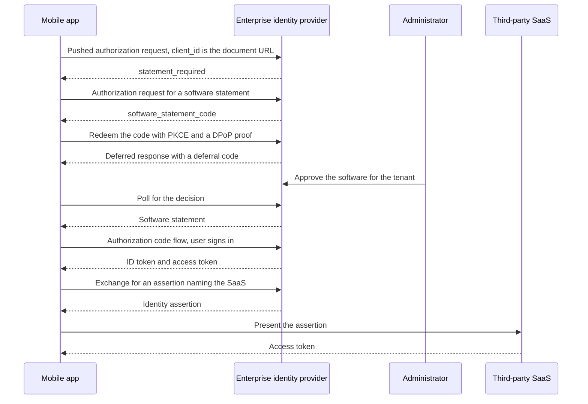

# Sketch: A Mobile App from Install to Third Party

A non-normative walkthrough of one scenario end to end: an employee installs an app from an app store, the enterprise identity provider refuses it as unreviewed, the app obtains a software statement and waits for an administrator, signs the user in, and then reaches a third-party SaaS through an identity assertion. It exercises the statement and issuance drafts plus the Identity Assertion Authorization Grant.

Claims here are of three kinds, and the text says which where it matters: **defined by the drafts** (a draft in this repository specifies it), **deployment policy** (a choice the drafts leave to an operator), or **proposed extension** (something no draft defines yet).

The family serves this case better than it did and still does not serve it fully. What it cannot give a mobile install is at the end, stated rather than smoothed over.

## The cast

| Party | Role here |
| --- | --- |
| The app | A public client on a phone, one install among many, identified by a Client ID Metadata Document URL compiled into it |
| The publisher | Hosts that document and nothing else in this flow |
| The enterprise identity provider | The authorization server the employee signs in to, and also the reviewer that issues statements |
| The administrator | Approves the software for the tenant, out of band |
| The third-party SaaS | A separate authorization server the app reaches on the user's behalf |

## Two reviews, and only one of them travels

The app store already reviewed this app before listing it. That review is real, but it is not portable and the enterprise identity provider cannot consume it: there is no artifact, no digest, and no way to ask whether it still stands. The enterprise's question is a different one anyway, since it is deciding whether its own people may use this software against its own tenant. This is the same two-review distinction [the deployment model](deployment-model.md#the-situation-being-addressed) opens with, arriving from the other end.

## Walkthrough

### 1. Install

The app ships with its client identifier, an HTTPS URL the publisher hosts. The document there carries `client_name`, `logo_uri`, `redirect_uris`, `token_endpoint_auth_method` of `none`, and the grant types and scopes the software uses. It carries no key material, because a private key inside a distributed binary is in every copy and identifies the software rather than the installation.

### 2. First sign-in, refused

The app sends a pushed authorization request to the enterprise identity provider with its Client ID Metadata Document URL as `client_id`. The server resolves the document and finds no statement from a reviewer it trusts for this tenant. It answers `statement_required`.

That error is the whole point of this step. It also reaches a plain authorization request, returned through the redirection once the server has resolved the app's document and validated the redirect URI against it, so an app that has not adopted PAR still learns what it is missing rather than only that it is unauthorized.

### 3. Asking for a statement

The app reads the identity provider's authorization server metadata to find that it issues statements, then sends an authorization request:

| Parameter | Value |
| --- | --- |
| `response_type` | `software_statement_code` |
| `client_id` | the same Client ID Metadata Document URL |
| `redirect_uri` | an HTTPS universal or app link |
| `code_challenge_method` | `S256`, with `code_challenge` and `state` |
| `dpop_jkt` | the thumbprint of a key the app generated on the device |
| `completion_mode` | includes `deferred`, hinting that the decision may not be immediate |
| `audience` | the identity provider's own issuer identifier, the one server where this decision applies |

Two constraints bite here. A public client must use an HTTPS redirection URI in a statement request and may not use a private-use scheme or a loopback address, so the app needs universal links or app links for this flow specifically. And `dpop_jkt` is required for a public client, so the app proves possession of a key it generated itself.

The approval stays local to the identity provider. An administrator approving software for one tenant makes a tenant-scoped decision, and the statement draft requires a statement carrying one to name exactly one authorization server in `aud`, and the tenant in `aud_tenant` unless the server's trust configuration already confines the issuer to it. Naming the third-party SaaS as a second audience would not make the decision apply there, and the issuer cannot add an audience the request did not name. The SaaS is reached in step 9 through an identity assertion, which carries the enterprise's permission per grant. If the SaaS wanted a review of its own, that would be a separate statement from a reviewer it trusts, naming the SaaS as `aud`, under the SaaS's own trust configuration.

### 4. Approval happens out of band

The employee authenticates and the identity provider returns a `software_statement_code` to the redirect. The app redeems it at the token endpoint under `grant_type=urn:ietf:params:oauth:grant-type:software-statement`, with its PKCE verifier, a DPoP proof, and `completion_mode` including `deferred`, which an issuer that may defer requires at redemption.

Nobody has approved this software yet, so the identity provider answers with a Deferred Token Response carrying a deferral code, and the app polls. The administrator approves in the console minutes or days later.

### 5. The statement arrives

A later poll returns the statement as `access_token`, with `issued_token_type` of `urn:ietf:params:oauth:token-type:software-statement` and `token_type` of `N_A`. Its `iss` is an issuer identifier the identity provider uses for this enterprise alone, since the statement draft requires an issuer reviewing for several customers to use a distinct `iss` for each. It names the document URL as `sub`, the digest of the exact octets reviewed as `cimd_digest`, and the identity provider alone as `aud`, with an expiry and a `status` reference if this issuer publishes status. It needs no `aud_tenant`, because the identity provider's trust configuration confines that issuer to the enterprise's tenant.

### 6. Admitted, without presenting anything

The identity provider issued this statement, so it already holds the decision. It admits the client on its own record rather than requiring the statement to be handed back.

Holding the record does not save it the checks. It confirms the decision is unexpired and its status current, re-reads the document at `sub`, and compares the digest against the one it recorded. A decision it made is not a document it has re-read, and the app's metadata may have changed since.

No registration is created. The app's `client_id` stays its Client ID Metadata Document URL.

The record replaces only the statement's signature, not the presenter proof. The app's sign-in request binds a key again, through `dpop_jkt` or a DPoP proof at the pushed authorization request endpoint, with PKCE and a reviewed `https` redirection URI, exactly as a presentation would. The key the app bound during issuance does not carry over to admission. The app can bind the same device key, but it proves it afresh. The limit step 7 describes applies here too, and needs no copy of the statement: an app that controls the user agent and uses this `client_id` completes a grant on the identity provider's record.

### Why export the decision at all

When the identity provider both decides and enforces, the round trip through a statement is optional, a matter of deployment policy. It could record the administrator's decision as its own policy and admit the app on it, and a deployment that stops there loses nothing at this server. Issuing a statement earns its place in three cases: the decision needs a durable record of exactly which document was approved and when the approval lapses; the same issuance flow has to serve reviewers that are not the consuming server (step 7); or the decision should lapse and renew on a schedule rather than persist until someone deletes it.

### 7. If the reviewer were somebody else

Had the review come from an app marketplace rather than from the enterprise, the identity provider would hold no record, and the app would present the statement in a pushed authorization request, or its publisher would publish it where the document points for the identity provider to pull. A public client cannot prove a key its document carries, so the binding is the reviewed document's redirection URIs together with PKCE: an authorization code opened by the presentation is delivered only to a URI the reviewer looked at. That is why every such URI must use `https` on a host no other application can claim: one private-use scheme or loopback address in the document makes the statement review-only, recorded but admitting nothing.

The key the app binds in that request, through `dpop_jkt` or a DPoP proof, becomes the proven key of the establishment, and code redemption and refresh re-prove it. What results is grant continuity plus redirect binding: the code reaches only a redirection URI the reviewer looked at, and the grant stays with the key that opened it. Neither says which executable holds the key.

That binding has a limit the statement draft states in its considerations for copied statements and public clients. A party that controls the user agent, such as an application embedding a browser view, or one that authorizes with its own account, receives the code itself and redeems it with a PKCE verifier and key of its own choosing. This flow therefore cannot enforce that employees run only approved software: an unreviewed app holding a copy of the statement completes a grant for any user who chooses to run it.

This path exists only where a redirect follows: at the pushed authorization request endpoint, or at the authorization endpoint with a pulled statement. At the token endpoint there is no redirect to bind, so a public client's presented statement is refused there and a pulled one is review-only.

### 8. Sign-in succeeds

The app runs an ordinary authorization code flow, with PKCE and tokens bound to its device key. The user signs in.

### 9. Reaching the third party

The app needs data in a third-party SaaS. It exchanges its identity provider token for an Identity Assertion Authorization Grant assertion naming that SaaS, and presents the assertion at the SaaS authorization server for an access token.

One act carries two decisions, which [the deployment model](deployment-model.md#composition-with-id-jag) works through: an application the administrator has not approved receives no assertion at all.

A proposed optional `cimd_digest` claim in that assertion would let the SaaS resolve the app's document, compare the digest, and provision just in time with no registration of its own. That is a proposed extension, on [an open issue](https://github.com/oauth-wg/oauth-identity-assertion-authz-grant/issues/121), not settled work.

### 10. Offboarding

The administrator withdraws approval. The identity provider sets the statement's status and stops renewing. Each stage stops on its own condition:

* **New admission** at the identity provider stops at once, since it issued the statement and already holds the withdrawal.
* **Refresh** of an open grant there is refused at its next use unless a replacement accompanies it.
* **New assertions** stop at once, since the identity provider stops issuing them.
* **Assertions already issued** remain usable at the SaaS until they expire. The Identity Assertion Authorization Grant recommends against downstream refresh tokens but does not forbid them, so where the SaaS issued one, that grant continues under the SaaS's own refresh policy.
* **Access tokens already issued**, at either server, run out on their own clock.

## The flow

## What each step relies on

| Step | Draft | Section |
| --- | --- | --- |
| Refusal at first sign-in | Statement | Error Responses |
| Requesting a statement | Issuance | Software Statement Authorization Request |
| Waiting for an administrator | Issuance | Deferred Processing |
| Receiving the statement | Issuance | Software Statement Token Response |
| Admission without presentation | Issuance | Issuer as Trusting Authorization Server |
| Presenting as a public client | Statement | Public Clients |
| Binding the grant to one install | Statement | Grant Binding |
| Ending open grants on withdrawal | Lifecycle | Refresh |
| Withdrawal before expiry | Lifecycle | Withdrawal and Refusal Records; Token Status List |
| Reaching the third party | Not in this family | Identity Assertion Authorization Grant |

## What is still missing

Neither path above gives the installation a cryptographic identity. The device key binds a grant to whichever phone opened it, but nobody vouches for that key, so the authorization server learns that the same installation came back and never learns which installation it is.

**Endorsing the instance's own key** is what would supply that. The app already holds a device-generated key, and platform attestation could vouch for it. The statement draft names this as an extension point, and the attested-keys draft defines it for native applications that redirect to loopback through PAR: an attester the authorization server trusts vouches for an installation's key under a named evidence policy, and the server binds the grant to that key. That draft does not permit `https` universal or app links, so a mobile profile of it would be a proposed extension, with redirect rules of its own. Until one exists, executable identity is a separate assurance from anything in this walkthrough.

## Open questions

* **Nothing tells the app where to go after the refusal.** It has to already know that this authorization server issues statements and that it is the right reviewer for its own admission. An error carrying that pointer would close the loop, and the family deliberately withholds issuer-trust detail from unauthenticated requesters, so the two goals are in tension. This is the client-side face of the discovery gap [the deployment model](deployment-model.md#what-these-drafts-do-not-solve) names, where a federation is the in-band answer.
* **What a copied statement is worth against a public client.** Against another user, it opens a consent prompt wearing the reviewed software's branding, raised by a party that cannot receive what that user approves, since the code reaches only a URI the reviewer looked at. For a party that controls the user agent or authorizes with its own account, it is a working admission, as step 7 says. Audience, lifetime, status, and rate limiting narrow both.
* **Whether the enterprise identity provider should be the reviewer at all** in this scenario, or whether the app store's review should be the thing that travels, which would need an artifact no app store publishes today.
